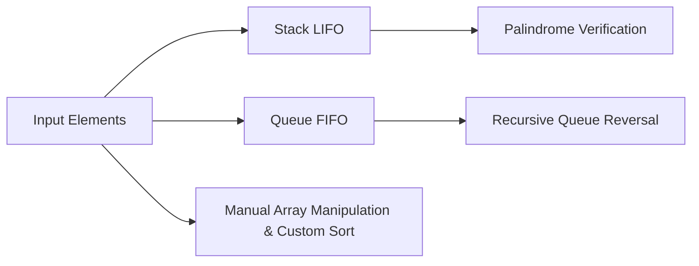

<p align="center">
  
</p>

<p align="center">
    
</p>


## 📌 Table of Contents
- [📖 Executive Summary](#-executive-summary)
- [✨ Key Features & Capabilities](#-key-features--capabilities)
- [🏗️ System Architecture & Workflow](#️-system-architecture--workflow)
- [🛠️ Tech Stack Breakdown](#️-tech-stack-breakdown)
- [⚙️ Reproducible Quickstart & Setup](#️-reproducible-quickstart--setup)
- [📂 Project Directory Layout](#-project-directory-layout)
- [👩‍💻 Author & Contributions](#-author--contributions)

---

## 📖 Executive Summary
### Problem Statement
Mastering practical data structures requires translating theoretical queue, stack, and array concepts into working, verifiable Python implementations.

### Motivation & Solution Overview
A modular collection of interactive Jupyter notebooks implementing custom data structures, recursive queue reversals, maximum-element tracking queues, palindrome stack validators, and sort algorithms.

---

## ✨ Key Features & Capabilities
- **Queue Engineering:** Recursive queue reversal and maximum element query support in $O(1)$.
- **Stack Algorithms:** Palindrome string/sequence validation utilizing LIFO stack mechanics.
- **Array Transformations:** In-place sorting and array operations implemented without reliance on Python built-ins.

---

## 🏗️ System Architecture & Workflow


---

## 🛠️ Tech Stack Breakdown
| Category | Technologies |
|---|---|
| **Language** | Python 3.9+ |
| **Environment** | Jupyter Notebook, VS Code |
| **Topics Covered** | Stacks, Queues, Recursion, Custom Array Sorting |

---

## ⚙️ Reproducible Quickstart & Setup
### Setup
```bash
git clone https://github.com/Bhumikaravi/datastructures-usingpy.git
cd datastructures-usingpy
pip install jupyter
jupyter notebook
```

---

## 📂 Project Directory Layout
```text
datastructures-usingpy/
├── 2. Reverse a Queue Using Recursion.ipynb
├── Array Operations.ipynb
├── check if a stack is a palindrome.ipynb
├── Design a Queue that Supports max() Operation.ipynb
├── descending order without built in.ipynb
├── find sum and avg.ipynb
└── README.md
```

---

## 👩‍💻 Author & Contributions
Developed by **Bhumika Ravi** ([@Bhumikaravi](https://github.com/Bhumikaravi)), Bachelor of Computer Applications (BCA) at **Alliance University, Bengaluru**.

- 💻 **GitHub Profile:** [github.com/Bhumikaravi](https://github.com/Bhumikaravi)
- 🔗 **LinkedIn:** [linkedin.com/in/bhumika-ravi-b5a01b326](https://www.linkedin.com/in/bhumika-ravi-b5a01b326/)
- 📬 **Email Contact:** [bhumikaravi2006@gmail.com](mailto:bhumikaravi2006@gmail.com)

---

<p align="center">
  
</p>
